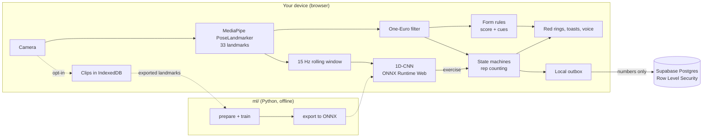
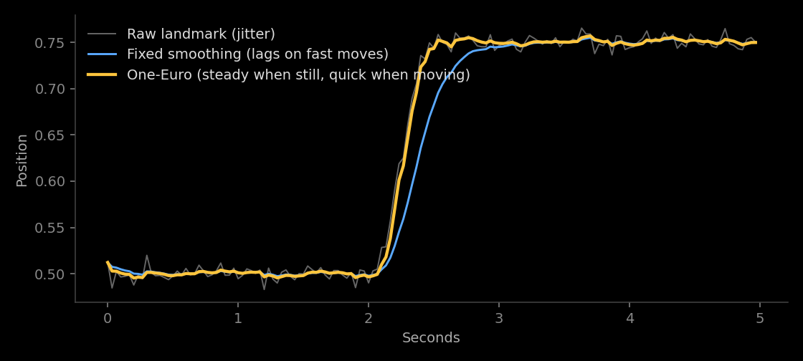

# RepSense

**A privacy-first AI calisthenics coach that runs entirely in your browser.** Point your phone at yourself and it counts reps, checks your form and talks you through corrections. Pose tracking and the exercise classifier run on your device, so your video never leaves it.

**Live app:** https://rep-sense-amber.vercel.app

<!-- DEMO: add a hero GIF and a 90-second demo video link here. -->

     

## What it does

- **Rep counting** for squats, push-ups, pull-ups, dips and lunges, plus a plank timer that pauses when your form breaks.
- **Form feedback:** a red ring on the joint that's off, a short cue on screen and spoken aloud, and a 0–100 score for every rep.
- **Guided workouts:** a pre-workout check-in that adapts the session, a camera placement tip, a countdown, set logging and a summary.
- **Auto-detect:** just start moving, and an on-device model works out the exercise and switches the counter.
- **Progress:** streaks, reps per day, form trend, calendar and full session history, once you sign in.
- **Clip recorder:** save your own clips on your device, watch them back with the skeleton on top, and export landmarks to train the model.
- **Installable** on a phone home screen.

## Architecture



There is no custom backend. The browser does the AI work; Supabase handles login and stores workout numbers, with Row Level Security enforcing that each person can only reach their own rows.

## How it works

**Joint angles.** A joint's angle comes from the two bones meeting at it:

$$\theta = \arccos\left(\frac{\vec{BA}\cdot\vec{BC}}{|\vec{BA}|\,|\vec{BC}|}\right)$$

Angles are measured in pixels, because normalised x and y have different scales on a 16:9 frame. The side the camera sees best is picked automatically.

**Smoothing.** Pose landmarks jitter. A plain filter trades jitter for lag; the [One-Euro filter](https://gery.casiez.net/1euro/) adapts, smoothing heavily when you're still and barely at all when you move fast.



*Simulated signal, to show the idea.*

**Rep counting.** Each exercise is a state machine with **hysteresis**: for a squat you enter "down" below 100° and the rep only counts back above 160°. Jitter around one threshold can't double-count, because a rep has to cross both. Attempts that stop halfway become a cue ("Go lower") rather than a silent miss.

**Form rules.** Each coaching cue is a pure function of the pose. Rules declare which camera view they're valid for (knees caving needs the front, hip sag needs the side), and the app detects the view from shoulder width against torso length. An issue must hold for 300 ms before it counts, so one noisy frame can't fail a rep.

**Exercise classifier.** A small 1D-CNN reads 2 seconds of skeleton (30 frames at 15 Hz, 34 features per frame) and is compared against a Random Forest baseline. Windows are resampled by time, so 15 and 30 FPS cameras look the same to the model. It's evaluated leave-people-out, so every score comes from someone the model never trained on. `features.py` and `features.ts` are locked together by a test that compares them number by number.

## Results

Numbers here only come from real measurements in [`ml/reports/`](ml/reports).

| Metric | Result |
|---|---|
| Exercise classifier, macro-F1 (person-wise) | *Pending real clips: see [RESULTS.md](ml/reports/) once trained* |
| Rep-count accuracy | *Pending: [rep_counting.md](ml/reports/rep_counting.md)* |
| FPS with pose + model on a phone | *Pending* |
| Lighthouse (local production build, mobile: landing page) | Performance 96, Accessibility 100, Best Practices 100, SEO 100 |

> **Current model:** the app ships with a stand-in model trained on generated stick figures, marked "Preview" in the app, to prove the pipeline end to end. Its scores in [`RESULTS_synthetic.md`](ml/reports/RESULTS_synthetic.md) are not real-world results. Retraining on recorded clips replaces it.

## Privacy

- Pose tracking and classification happen on your device. Video is never uploaded.
- Saving a clip is opt-in, and clips stay in your browser's storage.
- With an account, only workout numbers go to the database: reps, durations, form scores, check-in answers.
- Every table has Row Level Security. The policies are in [`supabase/migrations`](supabase/migrations).

## Run it locally

Needs Node 24+.

```bash
cd web
npm install
npm run dev
```

The app works without any keys, signed out. To enable accounts, create a Supabase project, run [`0001_init.sql`](supabase/migrations/0001_init.sql) in its SQL editor, and copy `web/.env.example` to `web/.env.local` with your project URL and publishable key.

The camera needs HTTPS or localhost.

```bash
npm run test
npm run lint
```

To train the classifier on your own clips, see [`ml/README.md`](ml/README.md).

## Project layout

```
web/           Next.js app
  lib/pose/        landmarks, geometry, One-Euro filter, view detection
  lib/exercises/   one file per exercise: thresholds + form rules
  lib/workout/     set engine: the per-frame pipeline, form scoring, summary
  lib/ml/          features, rolling window, ONNX inference, auto-detect
  lib/data/        saving, stats, check-in, session suggestions
ml/            Python: dataset preparation, training, export
supabase/      database schema and security policies
docs/          project report and devlog
```

The logic is plain TypeScript with no React, so it's tested by replaying recorded landmark sequences through the same code the live camera uses.

## Future work

Form-quality ML model compared against the rules · video upload analysis · workout programs with progressive targets · an AI coach answering from your own stats · handstand and L-sit skills.
