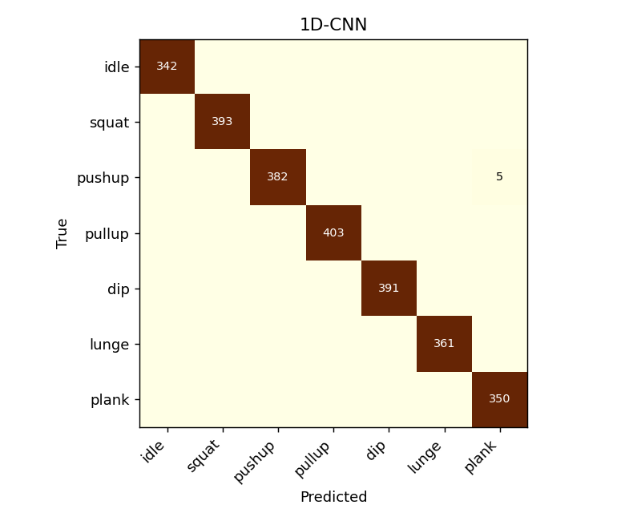
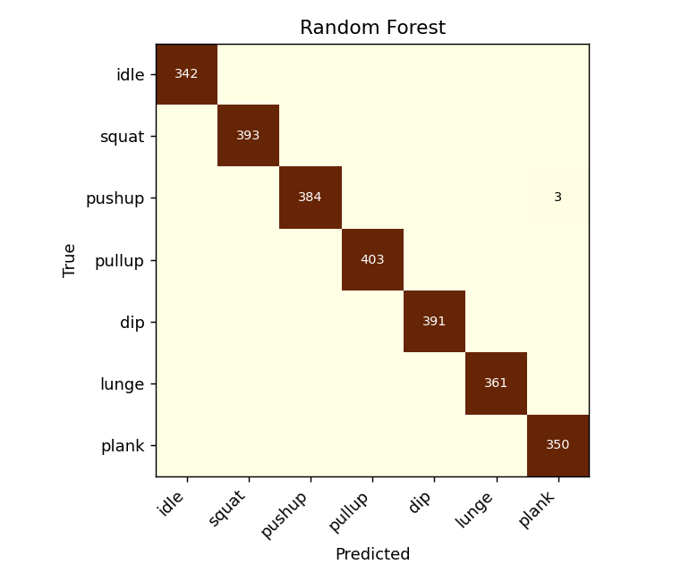

# Synthetic pipeline check

> **Not a result.** These numbers come from generated stick figures, which move far more
> cleanly than people. They only show that the pipeline runs. Don't quote them anywhere.

Generated by `python -m src.train --synthetic` on 2026-11-05.

## Dataset

- 84 clips, 2627 windows, 6 people
- Windows: 30 frames at 15 Hz (2 s), 34 features per frame
- Evaluation: 6-fold, split by person. Training folds are augmented; test folds never are.

## Models

| Model | Accuracy | Macro-F1 | Inference (one window, this CPU) |
|---|---|---|---|
| Random Forest (baseline) | 0.999 | 0.999 | 15.90 ms |
| 1D-CNN | 0.998 | 0.998 | 1.31 ms |

## F1 per class

| Class | Random Forest | 1D-CNN |
|---|---|---|
| idle | 1.000 | 1.000 |
| squat | 1.000 | 1.000 |
| pushup | 0.996 | 0.993 |
| pullup | 1.000 | 1.000 |
| dip | 1.000 | 1.000 |
| lunge | 1.000 | 1.000 |
| plank | 0.996 | 0.993 |

## Confusion matrix: 1D-CNN (windows)

| true \ predicted | idle | squat | pushup | pullup | dip | lunge | plank |
|---|---|---|---|---|---|---|---|
| **idle** | 342 | 0 | 0 | 0 | 0 | 0 | 0 |
| **squat** | 0 | 393 | 0 | 0 | 0 | 0 | 0 |
| **pushup** | 0 | 0 | 382 | 0 | 0 | 0 | 5 |
| **pullup** | 0 | 0 | 0 | 403 | 0 | 0 | 0 |
| **dip** | 0 | 0 | 0 | 0 | 391 | 0 | 0 |
| **lunge** | 0 | 0 | 0 | 0 | 0 | 361 | 0 |
| **plank** | 0 | 0 | 0 | 0 | 0 | 0 | 350 |

## Confusion matrix: Random Forest (windows)

| true \ predicted | idle | squat | pushup | pullup | dip | lunge | plank |
|---|---|---|---|---|---|---|---|
| **idle** | 342 | 0 | 0 | 0 | 0 | 0 | 0 |
| **squat** | 0 | 393 | 0 | 0 | 0 | 0 | 0 |
| **pushup** | 0 | 0 | 384 | 0 | 0 | 0 | 3 |
| **pullup** | 0 | 0 | 0 | 403 | 0 | 0 | 0 |
| **dip** | 0 | 0 | 0 | 0 | 391 | 0 | 0 |
| **lunge** | 0 | 0 | 0 | 0 | 0 | 361 | 0 |
| **plank** | 0 | 0 | 0 | 0 | 0 | 0 | 350 |
